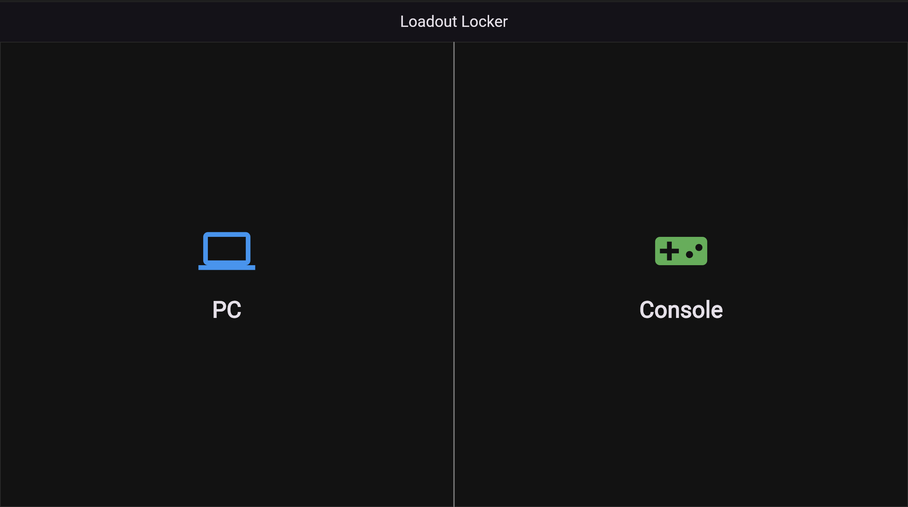
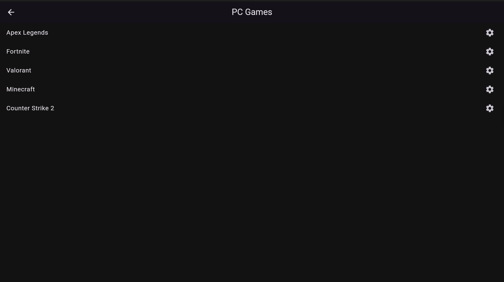
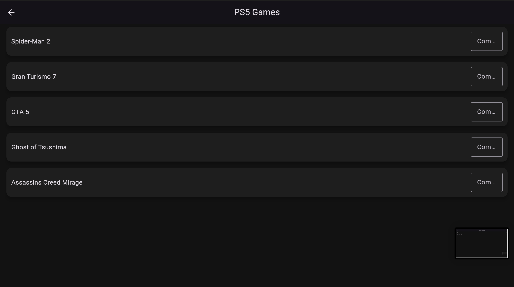

# Loadout Locker

A Flutter web app for gamers who play on several platforms. For PC games it stores your settings per game (DPI, sensitivity, graphics quality); for PS5 and Xbox games it tracks how far you are through each game with a progress bar.

<!-- Screenshots: GitHub shows these once the README points at them -->
| Home | PC games | PS5 games |
|---|---|---|
|  |  |  |

## Features

- **Two paths from the home page:** PC, or Console (then PS5 or Xbox)
- **Per-game PC profiles:** DPI and sensitivity (numbers only) and a graphics preset from Low to Ultra
- **Console progress tracking:** enter a completion percentage (0–100) and the progress bar updates immediately
- **Dark theme** with Material Design widgets

Settings are kept in memory while the app is open, so they reset when the page is reloaded. Saving them in the browser with the `shared_preferences` package is the next planned step.

## Running locally

Requires the [Flutter SDK](https://docs.flutter.dev/get-started/install) (3.27 or newer).

```
git clone https://github.com/anirrudhgg/Loadout_Locker_Dashboard.git
cd Loadout_Locker_Dashboard
flutter pub get
flutter run -d chrome
flutter test            # widget tests
```

## Project structure

```
├── lib/main.dart           The whole app: data store, pages and navigation
├── test/widget_test.dart   Widget tests: navigation, saving settings, input filtering
├── web/                    Flutter web entry point
├── screenshots/            Screenshots used in this README
└── Loadout Locker Presentation.pptx
```

## How it works

- `AppData` holds two maps: PC settings per game, and console progress per game
- Each screen is a widget; `Navigator.push` moves between them
- `PCProfilePage` loads the saved settings for a game into text fields and writes them back on **Save & Apply**
- `ConsoleGamesPage` rebuilds with `setState` whenever a percentage changes, which updates the progress bar

## Team

- Anirudh Gopishankar
- Yohan Amaratunga
